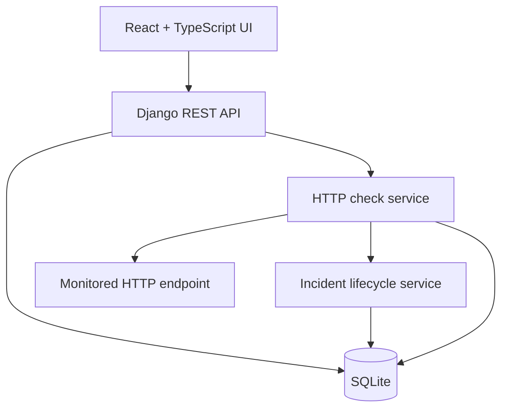

# OpsPilot

### Service monitoring and incident management, with a roadmap toward deployment operations.

[](https://github.com/dayanganganath/OpsPilot/actions/workflows/backend-ci.yml)

OpsPilot helps developers organize applications and environments, check service health, investigate saved check results, and follow incidents from failure to recovery.

**Status: In active development.** The current implementation supports manual HTTP checks and automatic incident lifecycle updates after each check. Scheduled checks and deployment integrations are planned.

## What works today

| Module | Implemented capabilities |
| --- | --- |
| Authentication | Session login, session restoration, logout, and CSRF protection |
| Applications | Create, view, edit, and enable or disable applications owned by the signed-in user |
| Environments | Manage Development, Staging, and Production environments for owned applications |
| Service monitors | Create and edit URLs, expected HTTP status codes, timeout settings, and enabled state |
| Health checks | Run checks on demand; record UP, DOWN, or ERROR, HTTP status, elapsed time, and errors |
| Check history | Review the latest 100 saved checks per monitor, including the URL and expected status captured at check time |
| Incidents | Open an incident after a failed check, keep it open across repeated failures, and resolve it after recovery |
| Dashboard | View application totals, monitor health counts, and open or resolved incident counts |
| Access control | Scope API records to their owner and reject access to another user's resources |
| Quality checks | Backend automated tests, migration checks, frontend lint, TypeScript compilation, and production build in GitHub Actions |

Applications, environments, and monitors support creation and updates through the API; deletion is intentionally unavailable. Incident records are read-only through the API and updated by the monitoring workflow.

## Example workflow

1. Create an application and a Development environment.
2. Add a monitor for its health endpoint.
3. Select **Check now** to save a result.
4. An unexpected HTTP status or connection error opens an incident.
5. Repeated failures keep the existing incident open.
6. A subsequent successful check resolves the incident and records its recovery check.
7. Review history, incidents, and refreshed dashboard metrics.

A configured check interval is stored with each monitor. **Checks currently run only when requested; a background scheduler has not been implemented yet.**

## Technology stack

| Area | Current technologies |
| --- | --- |
| Backend | Python 3.13, Django 5.2, Django REST Framework |
| Frontend | React 19, TypeScript, React Router, Vite |
| Database | SQLite for local development |
| HTTP checks | HTTPX |
| Authentication | Django sessions and CSRF tokens |
| Testing | Django TestCase, DRF APITestCase, unittest.mock |
| CI | GitHub Actions |
| Developer tools | Git, npm, ESLint |

## Skills demonstrated

- **API design:** REST endpoints, serializer validation, relational data modeling, and database migrations.
- **Authorization:** User ownership checks, restricted related-object selection, and tests for cross-user access.
- **Frontend engineering:** Typed React components, routed screens, forms, loading states, and error handling.
- **Monitoring logic:** HTTP status evaluation, timeout handling, persisted results, and historical configuration snapshots.
- **Incident modeling:** Failure and recovery transitions, repeated-failure handling, and transactional persistence.
- **Testing:** Mocked HTTP requests, lifecycle tests, input validation tests, and authentication tests.
- **CI workflows:** Automated backend checks and frontend lint/build verification on pushes and pull requests.

## Architecture



The browser accesses the backend through Vite's development proxy. The backend performs HTTP checks and persists check results with incident updates. Application ownership is enforced on the server.

## Run locally on Windows

### Prerequisites

- Git
- Python 3.13
- Node.js 24 and npm

The commands below use PowerShell and the project's Python executable directly, so activating the virtual environment is optional.

### 1. Clone and prepare the backend

```powershell
Set-Location "$env:USERPROFILE"
git clone https://github.com/dayanganganath/OpsPilot.git
Set-Location "$env:USERPROFILE\OpsPilot"

py -3.13 -m venv .venv
.\.venv\Scripts\python.exe -m pip install -r requirements.txt
.\.venv\Scripts\python.exe manage.py migrate
.\.venv\Scripts\python.exe manage.py createsuperuser
.\.venv\Scripts\python.exe manage.py runserver 127.0.0.1:8020
```

If you already have a checkout, use that project folder and skip cloning and virtual environment creation.

Create your own login credentials when prompted. Password characters are hidden while typing.

### 2. Start the frontend in another terminal

```powershell
Set-Location "$env:USERPROFILE\OpsPilot\frontend"
npm.cmd ci
npm.cmd run dev -- --host 127.0.0.1 --port 5175 --strictPort
```

Keep both server terminals open.

| Service | Local address |
| --- | --- |
| Frontend | http://127.0.0.1:5175/ |
| Django admin | http://127.0.0.1:8020/admin/ |
| Backend health | http://127.0.0.1:8020/health/ |

Use `127.0.0.1` consistently with the current proxy and CSRF configuration.

The virtual environment, SQLite database, and generated development secret key belong to this checkout. They are excluded from version control.

## Try the monitoring demo

1. Sign in to the frontend using the account created above.
2. Create an application and an environment.
3. Create an enabled monitor with URL `http://127.0.0.1:8020/health/` and expected status `200`.
4. Run **Check now** and confirm an **UP** result.
5. Change the monitor's expected status to `204`, save, and run another check. The endpoint still returns 200, so the check records **DOWN** and opens an incident.
6. Restore the expected status to `200`, save, and check again. The incident should become **resolved**.
7. Review the saved checks and refresh the dashboard.

This demonstrates the failure and recovery workflow without changing or stopping another application.

## API overview

Except for the health endpoint and authentication bootstrap/login endpoints, the APIs below require authentication. Session-authenticated mutations require a valid CSRF token.

| Method | Endpoint | Purpose |
| --- | --- | --- |
| GET | `/health/` | Backend health |
| GET | `/api/auth/csrf/` | Obtain a CSRF token |
| POST | `/api/auth/login/` | Sign in |
| GET | `/api/auth/session/` | Read the current session |
| POST | `/api/auth/logout/` | Sign out |
| GET, POST | `/api/applications/` | List or create applications |
| GET, PUT, PATCH | `/api/applications/{id}/` | Read or update an application |
| GET, POST | `/api/environments/` | List or create environments |
| GET, PUT, PATCH | `/api/environments/{id}/` | Read or update an environment |
| GET, POST | `/api/monitors/` | List or create monitors |
| GET, PUT, PATCH | `/api/monitors/{id}/` | Read or update a monitor |
| POST | `/api/monitors/{id}/check-now/` | Run and save a check |
| GET | `/api/monitors/{id}/history/` | Read the latest saved checks |
| GET | `/api/incidents/` | List incidents |
| GET | `/api/incidents/{id}/` | Read an incident |
| GET | `/api/dashboard/summary/` | Read dashboard counts |

## Validation

From the project root:

```powershell
.\.venv\Scripts\python.exe manage.py check
.\.venv\Scripts\python.exe manage.py makemigrations --check --dry-run
.\.venv\Scripts\python.exe manage.py test
```

From the frontend folder:

```powershell
npm.cmd run lint
npm.cmd run build
```

The [CI workflow](.github/workflows/backend-ci.yml) runs backend and frontend checks in separate jobs. Frontend lint and build checks do not replace browser interaction tests.

## Roadmap

Planned work, in an approximate implementation order:

- [ ] Scheduled health checks with Celery, Redis, and Celery Beat.
- [ ] PostgreSQL integration and database concurrency validation.
- [ ] Docker Compose setup for the application and supporting services.
- [ ] Incident severity, assignment, comments, and an activity timeline.
- [ ] Teams and role-based permissions for shared workspaces.
- [ ] Notifications for service failures and recoveries.
- [ ] GitHub integration for build and deployment events.
- [ ] Release records, deployment history, and approval workflows.
- [ ] Audit logs for important user actions.
- [ ] Browser-based frontend tests.
- [ ] Production configuration, monitoring target restrictions, and deployment documentation.
- [ ] Hosted demo, screenshots, and a short walkthrough video.

## Current scope

This repository currently provides a local development setup with SQLite and Django debug settings. Dashboard metrics refresh on request, monitoring is manual, and access is organized by individual ownership. Production deployment and multi-team operations remain roadmap work.

---

Built by [Dayan Ganganath](https://github.com/dayanganganath).
